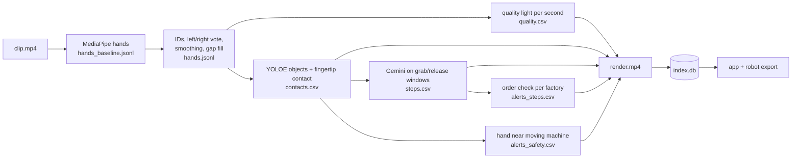

# EgoVision Data Engine

Turns raw head-camera factory video into graded, robot-ready hand data on a laptop CPU.
Every second gets a green/yellow/red quality light with reasons; hands, grab/release contacts, task steps,
order and safety alerts are reviewed in one app and exported as a LeRobot-style robot dataset.

**Problem statement:** PS5 (open innovation) built on PS1 (hand tracking), using PS2 contacts and PS3 steps.
**Hardware:** laptops only, CPU, no GPU. The only cloud call is the Gemini API for step captions (short
480p windows, faces blurred). Team: Caffeinated Nerds, Thapar Institute BIOS Hackathon finals, 31 Oct to 1 Nov 2026.

## Setup (once per laptop)
Python 3.11 and git.
```bash
git clone https://github.com/GunagyeJain/bios-finals.git && cd bios-finals
python3.11 -m venv .venv && source .venv/bin/activate     # Windows: .venv\Scripts\activate
pip install -r requirements.txt
pip install -e .
sh scripts/setup.sh                                        # commit hooks (block footage in git)
python scripts/check_env.py                                # every line should say OK
```
Put the organisers' clips at `data/egohack-data/clips_480p/` (git-ignored, never in this repo).
Step captions need `export GEMINI_API_KEY=...` (free key from Google AI Studio). Without it every stage still
runs and steps fall back to grab/release windows with `verb=other`.

## Run
```bash
python -m egovision run --all      # every stage on every clip → outputs/<clip>/ (resumable)
python -m egovision index          # builds outputs/index.db for the app
streamlit run app/Home.py          # review app
```
One stage, one clip: `python -m egovision run --clip <clip> --stage <stage> --force`.
Check outputs: `python -m egovision check --clip <clip>`. Robot dataset: `python -m egovision export --name demo --light green`.

## Pipeline

Each stage reads files and writes files; an existing output is skipped. Formats:
[`docs/05-solution/data-schema.md`](docs/05-solution/data-schema.md). Design: [`docs/05-solution/trd.md`](docs/05-solution/trd.md).

## The app
| Screen | Shows |
|---|---|
| Library | Every clip with its light share, hands found and alert count; filters by factory, light, demo |
| Clip review | Rendered video with a Baseline / Ours toggle; timeline of light, grab/release per hand, steps and alerts (click to jump); tabs for steps (with "Mark as reference"), safety alerts, flagged frames and quality numbers |
| Export | Filters (light, factory, grip, task), preview of episodes and minutes, Build dataset, datasheet |
| Metrics | Baseline vs ours on our labelled frames, accuracy per light colour, FPS, failure cases |

## Robot dataset (`exports/<name>/`, git-ignored)
```
meta/info.json          fps, episodes, frames, features and shapes, source clips, pipeline version
meta/episodes.jsonl     episode, clip, t_start, t_end, frames, task, light share, grip types, steps
meta/tasks.jsonl        task_index, task ("verb object" from steps)
data/chunk-000/episode_000000.parquet      one row per frame
videos/chunk-000/egocentric/episode_000000.mp4   faces blurred
datasheet.md            what, how, numbers, limits, licences, hardware
```
Parquet columns: `frame_index, timestamp, episode_index, task_index`, per hand `present, kp2d (42), kp3d (63),
score, source, contact, object`, then `step_index, light`. Episodes are green time of 3 s or more, split at
step boundaries; yellow only with `--light yellow`; red is never exported.

## Results
All numbers are in the app's **Metrics** page, computed from `outputs/<clip>/metrics.json`
(`python -m egovision.eval.metrics --clip <clip>`) against frames we labelled ourselves. We do not type
numbers into this README by hand.

How the labels were made: `python -m egovision.eval.label_tool --clip <clip> --labeller <name> --web` picks 60 %
hard frames and 40 % random ones. Points were pre-filled by rtmlib (RTMPose hand, a model the final pipeline
does not use as its result) and every frame was checked by a person. A shared 30-frame set per labeller is
fully hand-made, so the Metrics page can show whether pre-filling biased the numbers. Labels are coordinates
only (`eval/labels/`, format in data-schema §2).

## Data rules
- The footage belongs to the company that provided it and is used only for this hackathon.
- No videos, frames, screenshots or per-clip outputs in git: `data/egohack-data/`, `outputs/`, `exports/`
  are git-ignored, and the commit hooks and CI block media files.
- Faces are blurred (YuNet) in every export and in every window sent to the Gemini API; windows go inline with
  the request, nothing is left in API file storage.
- Every copy of the footage and outputs is deleted when the event ends.

## Licences
| Component | Licence |
|---|---|
| Footage | Owned by the company that provided it. Used under the hackathon data-use agreement: event use only, no redistribution, every copy deleted after the event. |
| MediaPipe Hand Landmarker | Apache-2.0 |
| rtmlib / RTMPose | Apache-2.0 |
| YOLOE (Ultralytics) | AGPL-3.0 |
| YuNet face detector (OpenCV Zoo) | MIT |
| WiLoR + MANO | CC-BY-NC-ND and MANO non-commercial licence; only where wilor.jsonl was used |

Other libraries and APIs: Google Gemini API (`google-genai`), Ultralytics CLIP, OpenCV, NumPy, SciPy, pandas,
PyArrow, ONNX Runtime, imageio-ffmpeg (bundles FFmpeg), Streamlit, Plotly, tqdm, pytest. Full list:
[`requirements.txt`](requirements.txt).

## Team
| Name | GitHub | Built |
|---|---|---|
| Gunagye Jain | [@GunagyeJain](https://github.com/GunagyeJain) | Core, contacts, render, export, app, Metrics page |
| Abhijay Nagal | _add_ | Hand tracking, metrics |
| Bhavyam Misra | [@bhavyammisra](https://github.com/bhavyammisra) | Quality light, face blur, safety, capture feedback |
| Shefali Sharma | [@shefali1702](https://github.com/shefali1702) | Label tool, step captions, order check, README, pitch |

Workflow: [`CONTRIBUTING.md`](CONTRIBUTING.md) · live status: [`STATUS.md`](STATUS.md).
