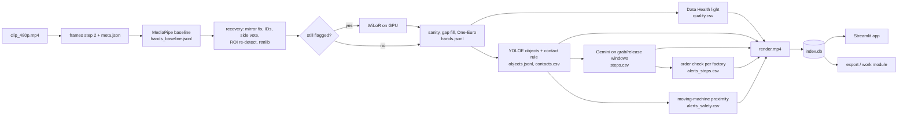
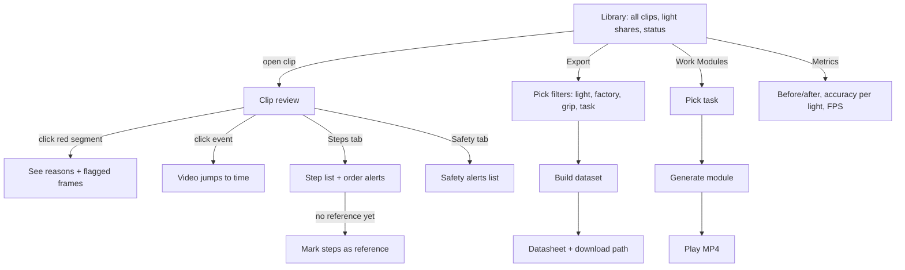

# App flow

_Two flows: the pipeline (offline, CLI) and the reviewer's path through the Streamlit app. Screens: `ui-design.md`._

## 1. Pipeline flow (per clip, resumable)

Stage contract: input files → output files. If an output exists, `run` skips the stage (`--force` to redo).

## 2. Reviewer flow in the app

## 3. Live demo script (5 min, preprocessed demo clips)
| Time | Screen | Say |
|---|---|---|
| 0:00 | Slide 1 | Problem: Mytron pays people to label raw head-cam video; much of it is unusable |
| 0:30 | Library | Every demo clip graded green/yellow/red, with numbers |
| 1:00 | Clip review | Hands through blur and gloves; baseline vs ours toggle |
| 1:45 | Red segment | "Too dark + hands out of frame": a reason, not a guess |
| 2:15 | Steps tab | Steps from grab/release + order alert |
| 2:45 | Safety tab | Hand close to a moving machine, timestamped |
| 3:15 | Export | Build the robot dataset live (green only); open the datasheet |
| 3:45 | Work Module | Play the 30 s training clip |
| 4:15 | Metrics | Accuracy on labelled frames, green vs red, FPS, what failed |
| 4:45 | Slide | Value + next steps |
Backup: screen recording of this exact path on Gunagye's and Shefali's laptops.

## 4. Error paths
| Case | What happens |
|---|---|
| Clip has no hands for long stretches | Segments red with `hands_out`; excluded from export |
| Gemini rate limit / error | Retry with backoff; step keeps `verb=other`, `source=contact`; app shows "caption pending" |
| WiLoR not available | Flagged frames keep rtmlib/MediaPipe result + flag; metrics say so |
| No repeated cycle in a factory | No order alerts; reference can be marked by hand in the app |
| Stage crashes | Earlier outputs stay valid; rerun that stage only |
